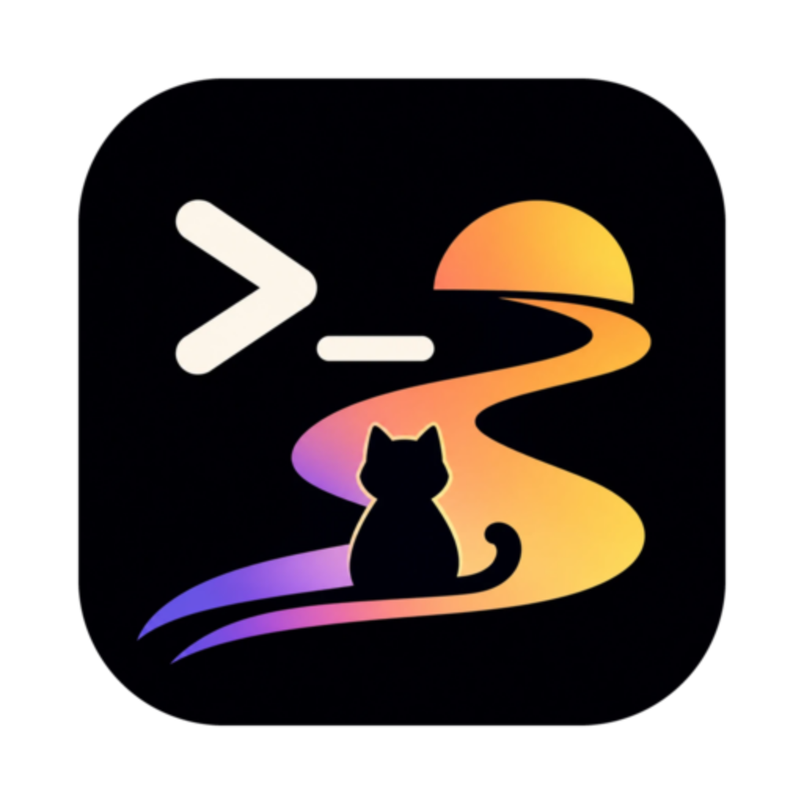

<h1 align="center">Seyir</h1>

<b>Claude ne yapıyor, canlı izle.</b> Rust ile yazılmış, Warp tarzı macOS terminali.

  <a href="https://github.com/Clay-Tech/seyir/releases/latest/download/Seyir.dmg"><b>⬇ macOS (Apple Silicon) · Seyir.dmg</b></a> &nbsp;·&nbsp;
  <a href="https://github.com/Clay-Tech/seyir/releases/latest/download/Seyir-Setup.exe"><b>⬇ Windows 10/11 · Seyir-Setup.exe</b></a> 
  <a href="https://clay-tech.github.io/seyir/">Tanıtım sayfası</a> ·
  <a href="https://github.com/Clay-Tech/seyir/releases">Tüm sürümler</a> ·
  <a href="https://github.com/Clay-Tech/seyir/issues">Öneri / hata bildir</a>

---

- **Seyir defteri:** Giriş kutusuna `#` ile yaz; Claude Code'un okuduğu dosyalar, aramalar, komutlar, diff'ler ve alt ajanlar canlı kutular olarak akar. Denemek için: `# demo`
- **Warp tarzı giriş kutusu**, **komut blokları**, sekmeler, bölmeler, komut paleti (⌘P), beş tema.
- 4 MB, Rust + GPU çizim. Ek token harcamaz; her şey makinende kalır.

### Kurulum

**macOS:** [Seyir.dmg](https://github.com/Clay-Tech/seyir/releases/latest/download/Seyir.dmg)'yi indir, Seyir'i Uygulamalar'a sürükle. İlk açılışta uyarı çıkarsa sağ tık › Aç, ya da `xattr -dr com.apple.quarantine /Applications/Seyir.app`

**Windows:** [Seyir-Setup.exe](https://github.com/Clay-Tech/seyir/releases/latest/download/Seyir-Setup.exe)'yi çalıştır (yönetici izni gerekmez). SmartScreen uyarırsa "Ek bilgi" › "Yine de çalıştır". Windows'ta kısayollar ⌘ yerine **Ctrl+Shift** ile çalışır (Ctrl+Shift+T, Ctrl+Shift+P…); kabuk PowerShell'dir.

Claude paneli için [Claude Code](https://claude.com/claude-code) kurulu olmalı.

Bu depo yalnız sürümleri ve tanıtım sayfasını barındırır.
